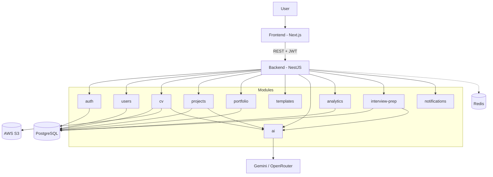
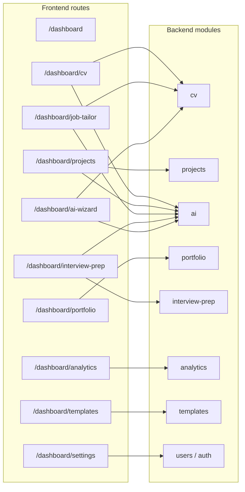
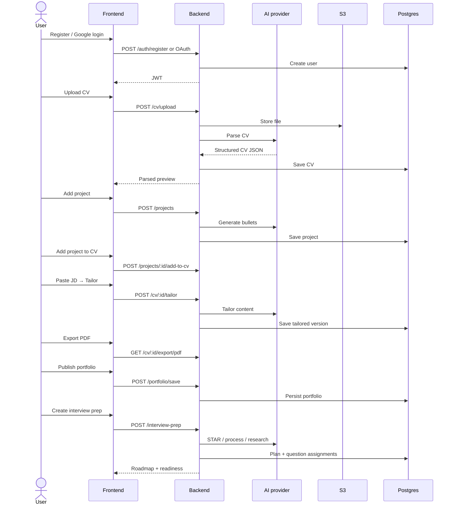
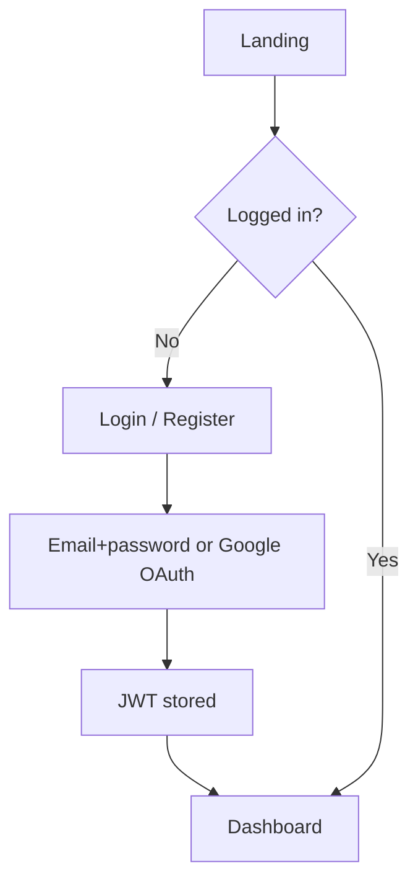
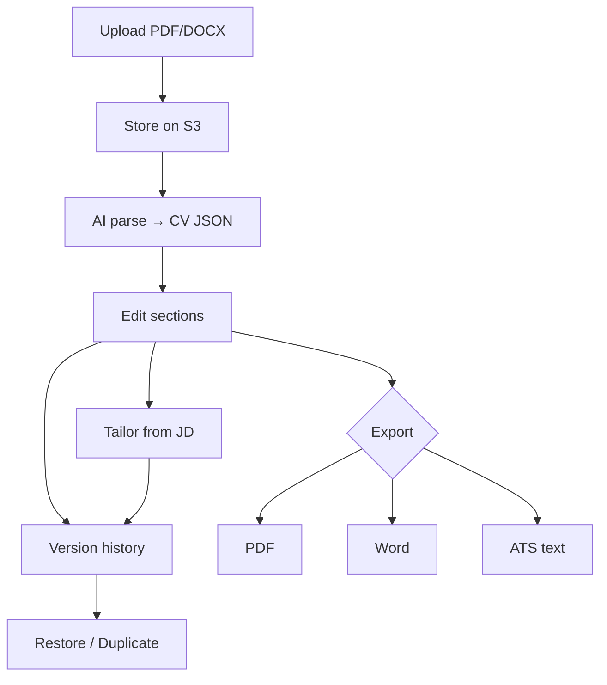
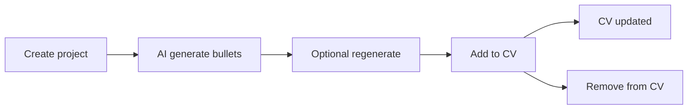
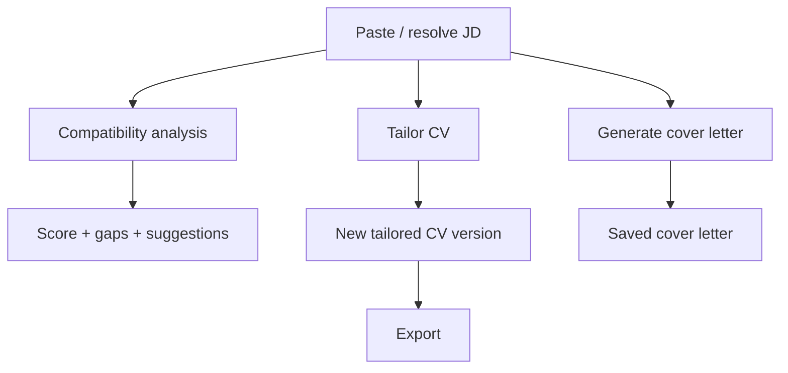
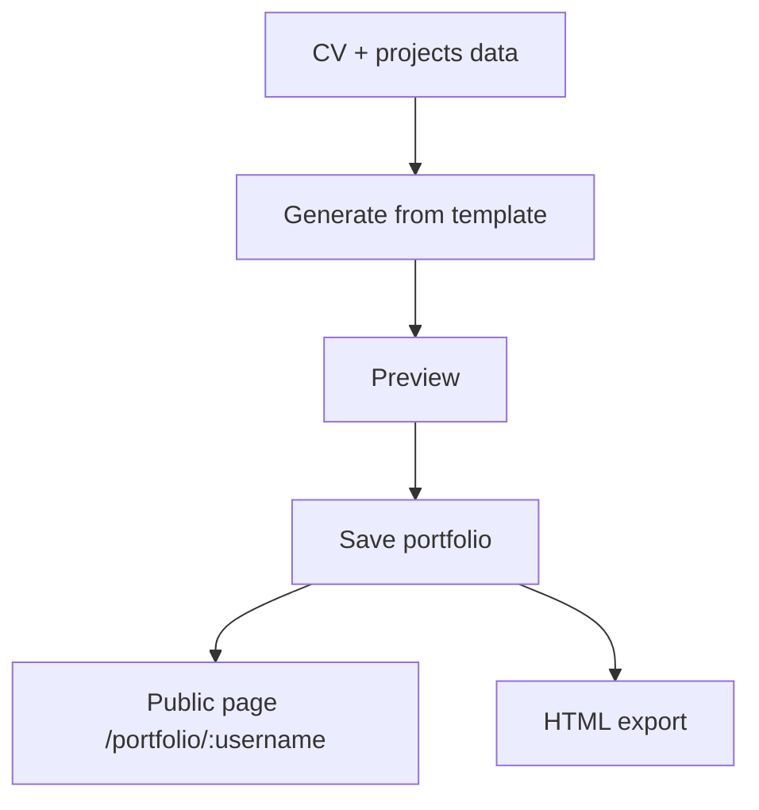
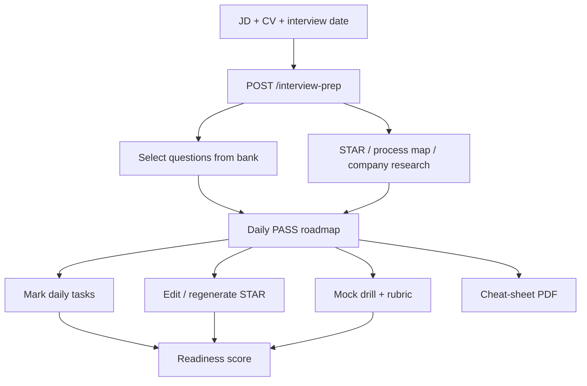
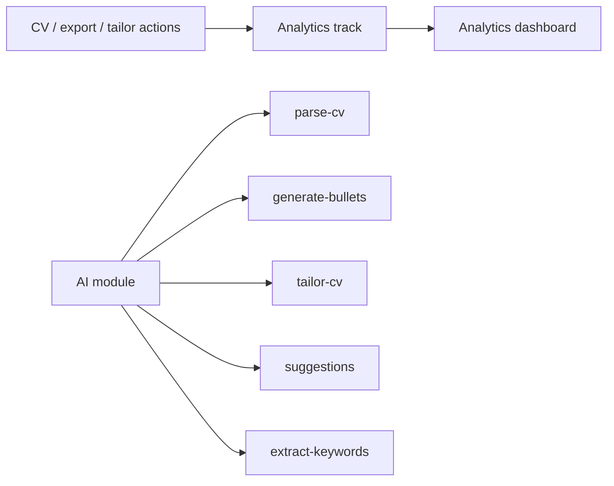

# Resumate

> Update your CV in minutes — tailor it to each job, then prep for the interview.

AI-assisted CV, portfolio, and interview prep for freelancers and job seekers. Upload a CV once, keep projects in sync, generate JD-specific versions, publish a portfolio, and run a structured interview roadmap.

---

## What it does

| Area | Capabilities |
|------|----------------|
| **CV** | Upload PDF/DOCX → AI parse → edit → version history / restore / duplicate → export PDF, Word, ATS |
| **Projects** | Add project → AI bullet points → attach / detach from CV |
| **Job Tailor** | Paste JD → tailored CV, compatibility score, cover letter |
| **Portfolio** | Template-driven public page (`/portfolio/:username`), HTML export |
| **Interview Prep** | JD + CV → PASS roadmap, curated question bank, STAR stories, mock drills, cheat-sheet PDF |
| **Extras** | Analytics dashboard, CV templates, dark mode, EN/VI UI, Google OAuth |

---

## Architecture & workflows

### System context



### App functions map

Feature areas in the sidebar ↔ frontend route ↔ backend module.



| Function area | User can… | Route | Module / main APIs |
|---------------|-----------|-------|---------------------|
| **Auth** | Register, login, Google OAuth | `/auth/*` | `POST /auth/register`, `login`, `GET /auth/google`, `/auth/me` |
| **CV** | Upload, edit, version, export | `/dashboard/cv` | `POST /cv/upload`, `PUT /cv/:id`, `restore`, `duplicate`, `export/*` |
| **AI Wizard** | Guided CV / quick build | `/dashboard/ai-wizard` | `POST /cv/quick-build`, AI parse helpers |
| **Projects** | CRUD + AI bullets + sync to CV | `/dashboard/projects` | `POST /projects`, `regenerate-bullets`, `add-to-cv`, `remove-from-cv` |
| **Job Tailor** | Tailor CV, score fit, cover letter | `/dashboard/job-tailor` | `POST /cv/:id/tailor`, `analyze-compatibility`, `generate-cover-letter` |
| **Interview Prep** | Plan, tasks, STAR, mock, PDF | `/dashboard/interview-prep` | `POST /interview-prep`, task/STAR/mock patches, cheat-sheet export |
| **Portfolio** | Generate, save, public page | `/dashboard/portfolio` | `POST /portfolio/generate`, `save`, `GET /portfolio/:username` |
| **Templates** | Browse / manage CV templates | `/dashboard/templates` | `GET/POST /templates`, `GET /cv/templates/available` |
| **Analytics** | Usage charts & activity | `/dashboard/analytics` | `GET /analytics/stats`, `timeline`, `exports-by-format` |
| **Settings** | Profile, password, language, theme | `/dashboard/settings` | `GET/PUT /users/profile`, `usage`, `export`, `DELETE /users/account` |

### End-to-end happy path



### Feature workflows

#### Auth



#### CV lifecycle



| Step | API |
|------|-----|
| Upload | `POST /cv/upload` |
| List / detail | `GET /cv`, `GET /cv/:id`, `GET /cv/:id/full` |
| Update | `PUT /cv/:id` |
| Duplicate / restore | `POST /cv/:id/duplicate`, `POST /cv/:id/restore/:version` |
| Export | `GET /cv/:id/export/pdf\|word\|ats`, `POST /cv/:id/export/pdf/dynamic` |
| Preview | `POST /cv/:id/preview` |
| Quick build | `POST /cv/quick-build` |

#### Projects → CV



| Step | API |
|------|-----|
| CRUD | `POST/GET/PUT/DELETE /projects` |
| Bullets | `POST /projects/:id/regenerate-bullets` |
| Sync | `POST /projects/:id/add-to-cv`, `remove-from-cv` |

#### Job Tailor



| Step | API |
|------|-----|
| Tailor | `POST /cv/:id/tailor` |
| Compatibility | `POST /cv/:id/analyze-compatibility` |
| Cover letter | `POST /cv/:id/generate-cover-letter` |
| History | `GET /cv/analyses`, `GET /cv/cover-letters` |

#### Portfolio



| Step | API |
|------|-----|
| Templates | `GET /portfolio/templates` |
| Generate / preview | `POST /portfolio/generate`, `preview` |
| Persist | `POST /portfolio/save`, `url`, `html` |
| Public | `GET /portfolio/:username`, `GET /portfolio/uuid/:uuid` |

#### Interview Prep



| Step | API |
|------|-----|
| Create / list / get | `POST /interview-prep`, `GET /interview-prep`, `GET /interview-prep/:id` |
| Resolve JD | `POST /interview-prep/resolve-jd` |
| Tasks | `PATCH /interview-prep/:id/tasks/:dayIndex/:taskId` |
| STAR | `PATCH .../star-stories/:i`, `POST .../regenerate` |
| Mock | `POST /interview-prep/:id/mock` |
| Company research | `PATCH .../company-research/:sectionId` |
| Survey / delete | `POST .../survey`, `DELETE /interview-prep/:id` |
| Export | `GET /interview-prep/:id/export/cheat-sheet/pdf` |

#### Analytics & AI helpers



| Area | API |
|------|-----|
| Analytics | `GET /analytics/stats`, `exports`, `activity`, `timeline`, `POST /analytics/track` |
| AI | `POST /ai/parse-cv`, `generate-bullets`, `tailor-cv`, `suggestions`, `extract-keywords`, `GET /ai/health` |
| Users | `GET/PUT /users/profile`, `PUT /users/password`, `GET /users/usage\|stats\|export`, `DELETE /users/account` |
| Templates | `GET/POST/PUT/DELETE /templates`, `POST /templates/seed` |

---

## Stack

| Layer | Tech |
|-------|------|
| Frontend | Next.js 15, React 19, TypeScript, Tailwind CSS 4, React Query, RHF + Zod |
| Backend | NestJS 11, TypeORM, PostgreSQL, Redis |
| AI | Google Gemini and/or OpenRouter (configurable per feature) |
| Files | AWS S3 |
| Auth | JWT + Google OAuth |
| Export | Puppeteer / React-PDF / docx |
| Ops | Docker Compose (dev/prod), deployment scripts under `deployment/` |
| Tests | Jest (backend), Playwright + Cucumber (`testing/`) |

---

## Repo layout

```
resumate/
├── frontend/          # Next.js app (landing + dashboard)
├── backend/           # NestJS API
├── deployment/        # Dev/prod scripts
├── testing/           # E2E / BDD
├── docker-compose*.yml
└── requiments/        # Product notes & historical feature docs (not always current)
```

### Backend modules

`auth` · `users` · `cv` · `projects` · `portfolio` · `templates` · `ai` · `analytics` · `interview-prep` · `notifications`

### Frontend routes (dashboard)

`/dashboard` · `/dashboard/cv` · `/dashboard/projects` · `/dashboard/job-tailor` · `/dashboard/portfolio` · `/dashboard/interview-prep` · `/dashboard/analytics` · `/dashboard/templates` · `/dashboard/settings` · `/dashboard/ai-wizard`

---

## Quick start

### Prerequisites

- Node.js 18+
- PostgreSQL
- Google AI and/or OpenRouter API key
- AWS S3 credentials (CV upload)
- Optional: Redis, Google OAuth, SMTP

### 1. Backend

```bash
cd backend
npm install
cp env.example .env
# Fill DB_*, JWT_*, AWS_*, and AI keys (see env.example)
npm run db:setup          # migrations + CV template seed
npm run start:dev         # http://localhost:5001
```

Key env (see `backend/env.example`):

```env
DB_HOST=localhost
DB_PORT=5432
DB_USERNAME=postgres
DB_PASSWORD=password
DB_NAME=postgres

AWS_ACCESS_KEY_ID=
AWS_SECRET_ACCESS_KEY=
AWS_REGION=us-east-1
AWS_S3_BUCKET=resumate-files

GOOGLE_AI_API_KEY=
GOOGLE_AI_MODEL=gemini-1.5-flash
OPENROUTER_API_KEY=
OPENROUTER_MODEL=google/gemini-2.5-flash
AI_CV_PARSE_PROVIDER=openrouter
AI_INTERVIEW_PREP_PROVIDER=openrouter

JWT_SECRET=
JWT_EXPIRES_IN=7d
PORT=5001
FRONTEND_URL=http://localhost:5005
```

> Nest scripts bind **5001**. Prefer `PORT=5001` over the sample `5000` in `env.example` if you run via `npm run start:dev`.

### 2. Frontend

```bash
cd frontend
npm install
# Optional: .env.local
# NEXT_PUBLIC_API_URL=http://localhost:5001
# NEXT_PUBLIC_APP_URL=http://localhost:5005
# NEXT_PUBLIC_INTERVIEW_PREP_ENABLED=true
npm run dev               # http://localhost:5005
```

### 3. Docker (optional)

```bash
docker compose -f docker-compose.dev.yml up
# Frontend :5000 · Backend :5001 · Postgres :5432
```

Or: `./deployment/start-dev.sh`

### URLs

| Service | Local (npm) | Docker / start-dev |
|---------|-------------|--------------------|
| Frontend | http://localhost:5005 | http://localhost:5000 |
| Backend | http://localhost:5001 | http://localhost:5001 |
| AI health | http://localhost:5001/ai/health | same |

---

## Plans (usage limits)

Enforced in `UsersService.checkUserLimit`:

| Feature | Free | Pro |
|---------|------|-----|
| CV uploads | 1 | Unlimited |
| Projects | 3 / period | Unlimited |
| Job tailor | 5 | Unlimited |
| Exports | 10 | Unlimited |
| Interview prep plans | 1 | Unlimited |
| Mock drills | 3 | Unlimited |

Pro also unlocks interview-prep pack features (mock scoring, cheat-sheet PDF, etc.).

---

## Docs map

| Doc | Role |
|-----|------|
| [requiments/IDEA.md](./requiments/IDEA.md) | Product intent (source of truth for “why”) |
| [requiments/INTERVIEW_PREP_FEATURE.md](./requiments/INTERVIEW_PREP_FEATURE.md) | Interview Prep contract & checklist |
| [requiments/JOB_TAILOR_FEATURES.md](./requiments/JOB_TAILOR_FEATURES.md) | Compatibility + cover letter |
| [deployment/README.md](./deployment/README.md) | Deploy / local scripts |
| [testing/README.md](./testing/README.md) | E2E harness |
| `requiments/*` other files | Historical notes — verify against code before trusting |

---

## Status (vs older README claims)

Already in the codebase (not “planned”):

- Interview Prep, analytics, dark mode, EN/VI i18n  
- Docker Compose + deployment scripts  
- S3 uploads, Redis config, OpenRouter provider  
- Backend Jest tests + Playwright suite under `testing/`  

Still optional / incomplete depending on env: Swagger UI, custom portfolio domain, CI polish, full production hardening.

---

## License

Private / UNLICENSED (see package manifests). Treat as internal unless you publish otherwise.
