# Resumate

AI-assisted CV, portfolio, and interview prep for freelancers and job seekers.

Upload a CV once, keep projects in sync, tailor versions to each job description, publish a portfolio, and run a structured interview roadmap.

---

## Table of contents

1. [Overview](#overview)
2. [Features](#features)
3. [Architecture](#architecture)
4. [Workflows](#workflows)
5. [Tech stack](#tech-stack)
6. [Getting started](#getting-started)
7. [Configuration](#configuration)
8. [Redis](#redis)
9. [Interview Prep RAG](#interview-prep-rag-pgvector)
10. [Plans & limits](#plans--limits)
11. [Project structure](#project-structure)
12. [Further reading](#further-reading)
13. [License](#license)

---

## Overview

| | |
|--|--|
| **Problem** | Updating CVs and portfolios for every project or JD is slow and inconsistent |
| **Approach** | Structured CV data + AI for parse / tailor / bullets / interview prep |
| **Clients** | Freelancers, consultants, developers and designers who change roles often |
| **Apps** | Next.js frontend · NestJS API · PostgreSQL · Redis · S3 · Gemini / OpenRouter |

---

## Features

| Area | Capabilities |
|------|----------------|
| **CV** | Upload PDF/DOCX → AI parse → edit → version history / restore / duplicate → export PDF, Word, ATS |
| **Projects** | Add project → AI bullets → attach / detach from CV |
| **Job Tailor** | Paste JD → tailored CV, compatibility score, cover letter |
| **Portfolio** | Template-driven public page (`/portfolio/:username`), HTML export |
| **Interview Prep** | JD + CV → PASS roadmap, curated question bank, STAR stories, mock drills, cheat-sheet PDF |
| **Platform** | Analytics, CV templates, dark mode, EN/VI UI, Google OAuth |

---

## Architecture

### System context

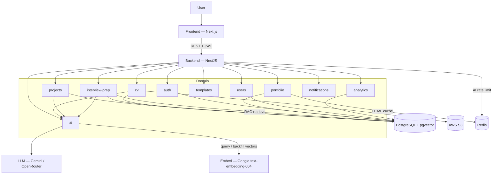

Redis: short-window **AI rate limits** + **public portfolio HTML cache** (fail-open if down).  
Prep RAG: embed JD → **pgvector** top‑K on `question_bank` → impact / PASS rank (see [RAG](#interview-prep-rag-pgvector)).

### Feature map

| Area | Route | Backend | Primary APIs |
|------|-------|---------|--------------|
| Auth | `/auth/*` | `auth` | `POST /auth/register`, `login`, `GET /auth/google`, `/auth/me` |
| CV | `/dashboard/cv` | `cv`, `ai` | `POST /cv/upload`, `PUT /cv/:id`, restore, duplicate, `export/*` |
| AI Wizard | `/dashboard/ai-wizard` | `cv`, `ai` | `POST /cv/quick-build` |
| Projects | `/dashboard/projects` | `projects`, `ai` | CRUD, `regenerate-bullets`, `add-to-cv` / `remove-from-cv` |
| Job Tailor | `/dashboard/job-tailor` | `cv`, `ai` | `tailor`, `analyze-compatibility`, `generate-cover-letter` |
| Interview Prep | `/dashboard/interview-prep` | `interview-prep`, `ai` | create plan, tasks, STAR, mock, cheat-sheet PDF |
| Portfolio | `/dashboard/portfolio` | `portfolio` | `generate`, `save`, `GET /portfolio/:username` |
| Templates | `/dashboard/templates` | `templates` | `GET/POST /templates` |
| Analytics | `/dashboard/analytics` | `analytics` | `stats`, `timeline`, `exports-by-format` |
| Settings | `/dashboard/settings` | `users` | profile, password, usage, account export/delete |

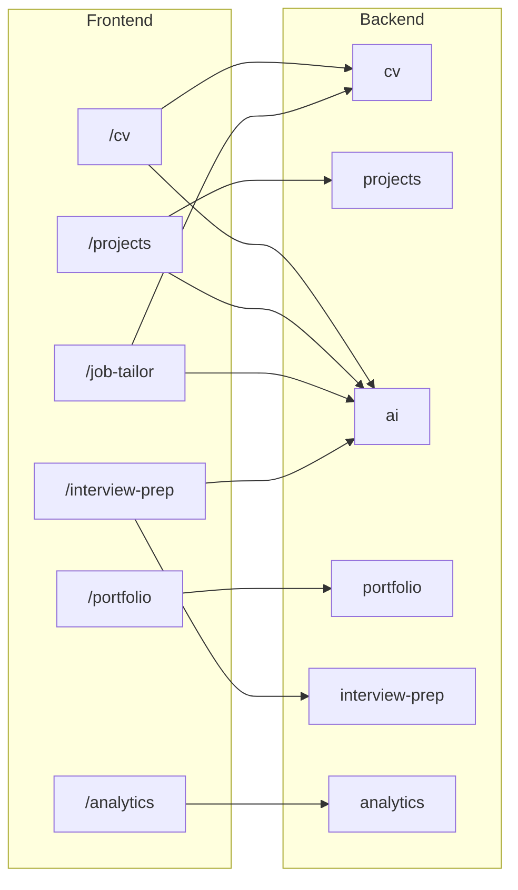

### End-to-end flow

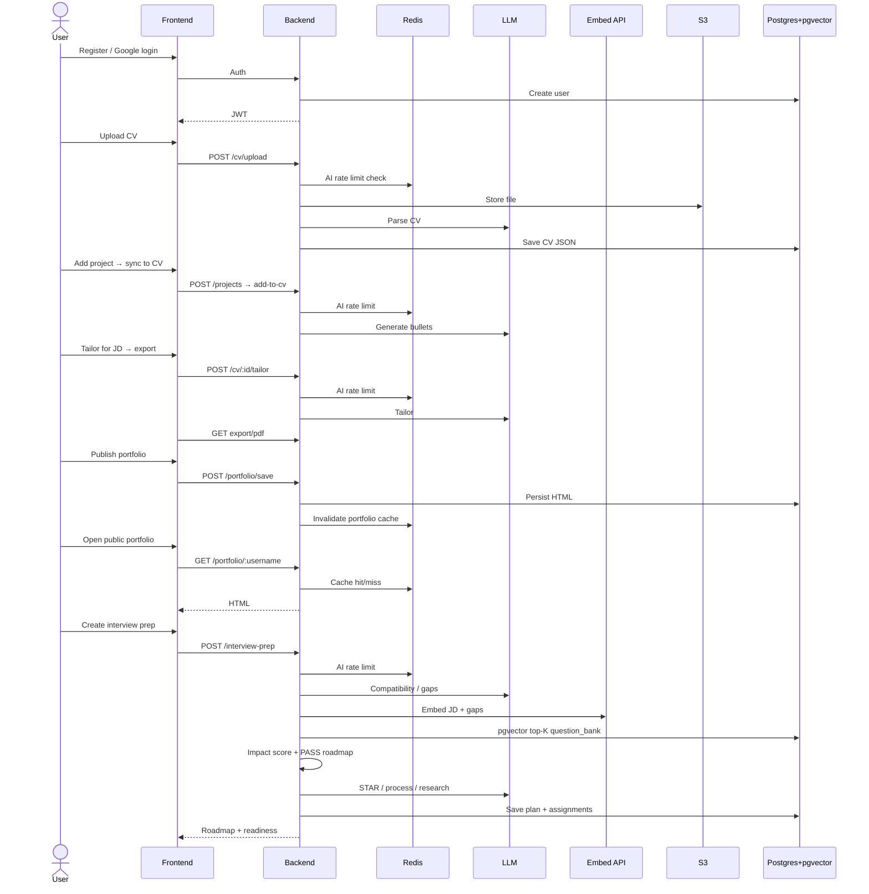

---

## Workflows

### Auth

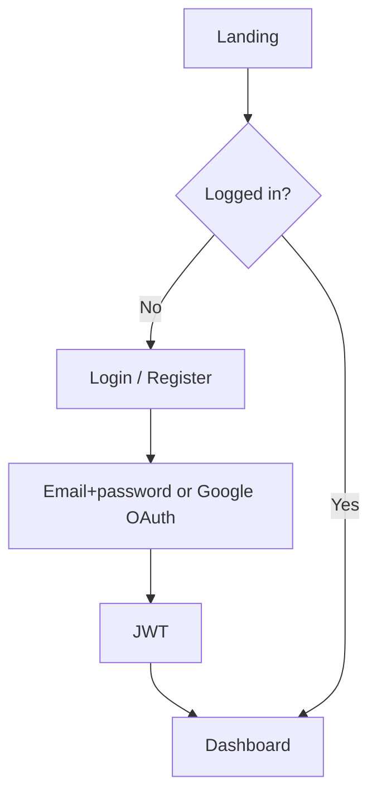

### CV

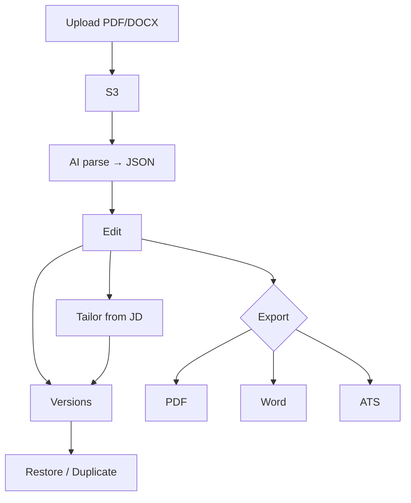

| Action | API |
|--------|-----|
| Upload | `POST /cv/upload` |
| List / detail | `GET /cv`, `GET /cv/:id`, `GET /cv/:id/full` |
| Update | `PUT /cv/:id` |
| Duplicate / restore | `POST /cv/:id/duplicate`, `POST /cv/:id/restore/:version` |
| Export | `GET /cv/:id/export/pdf\|word\|ats`, `POST /cv/:id/export/pdf/dynamic` |
| Preview / quick build | `POST /cv/:id/preview`, `POST /cv/quick-build` |

### Projects → CV

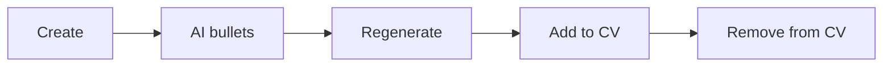

| Action | API |
|--------|-----|
| CRUD | `POST/GET/PUT/DELETE /projects` |
| Bullets | `POST /projects/:id/regenerate-bullets` |
| Sync | `POST /projects/:id/add-to-cv`, `remove-from-cv` |

### Job Tailor

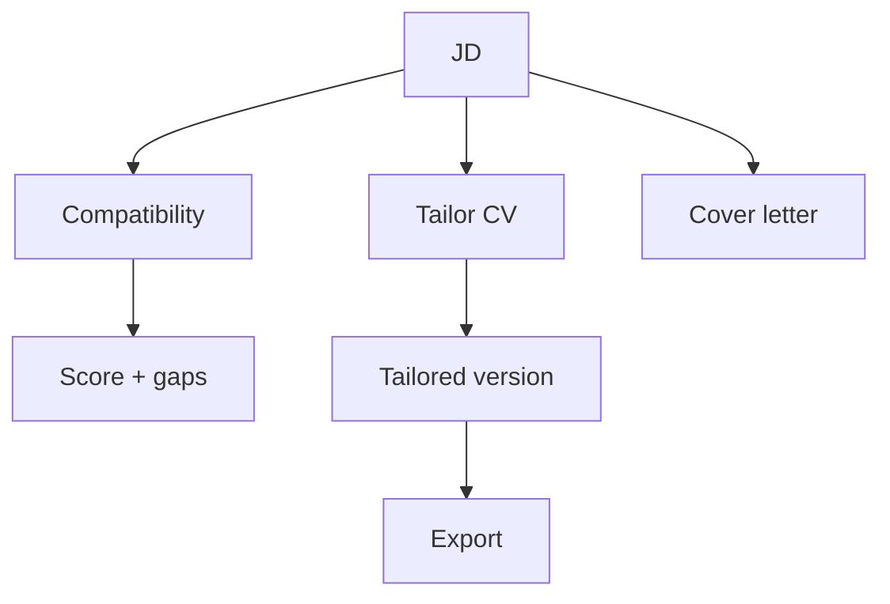

| Action | API |
|--------|-----|
| Tailor | `POST /cv/:id/tailor` |
| Compatibility | `POST /cv/:id/analyze-compatibility` |
| Cover letter | `POST /cv/:id/generate-cover-letter` |
| History | `GET /cv/analyses`, `GET /cv/cover-letters` |

### Portfolio

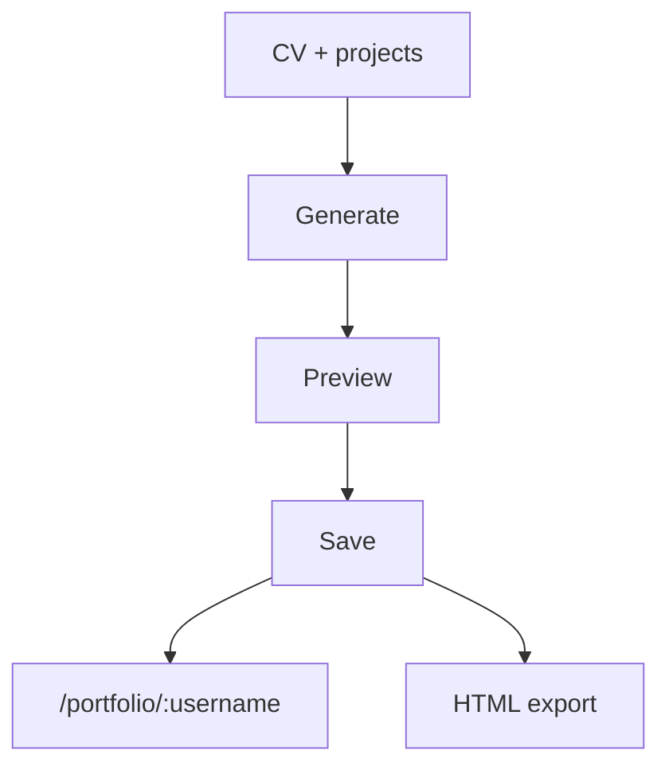

| Action | API |
|--------|-----|
| Templates | `GET /portfolio/templates` |
| Generate / preview | `POST /portfolio/generate`, `preview` |
| Persist | `POST /portfolio/save`, `url`, `html` |
| Public | `GET /portfolio/:username`, `GET /portfolio/uuid/:uuid` |

### Interview Prep

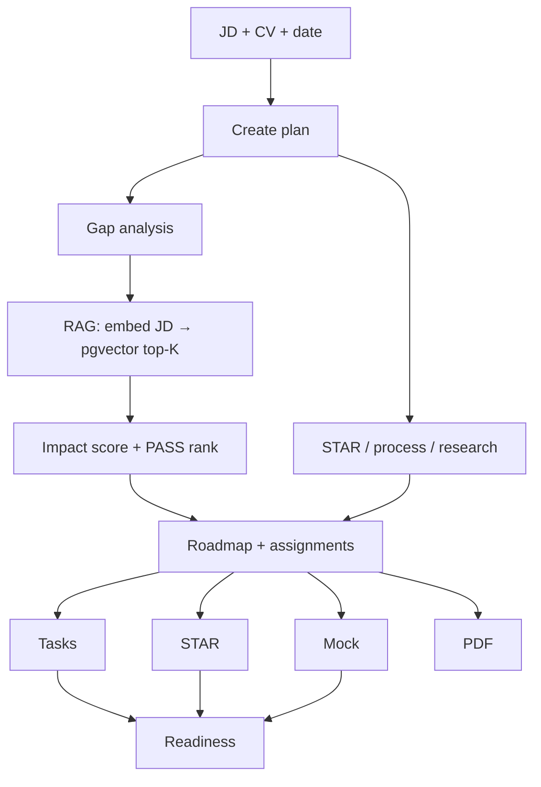

See [Interview Prep RAG](#interview-prep-rag-pgvector) for how retrieval hooks into this flow.

| Action | API |
|--------|-----|
| Create / list / get | `POST /interview-prep`, `GET /interview-prep`, `GET /interview-prep/:id` |
| Resolve JD | `POST /interview-prep/resolve-jd` |
| Tasks | `PATCH /interview-prep/:id/tasks/:dayIndex/:taskId` |
| STAR | `PATCH .../star-stories/:i`, `POST .../regenerate` |
| Mock / research / survey | `POST .../mock`, `PATCH .../company-research/:sectionId`, `POST .../survey` |
| Export | `GET /interview-prep/:id/export/cheat-sheet/pdf` |

### Analytics & AI helpers

| Area | API |
|------|-----|
| Analytics | `GET /analytics/stats`, `exports`, `activity`, `timeline`, `POST /analytics/track` |
| AI | `POST /ai/parse-cv`, `generate-bullets`, `tailor-cv`, `suggestions`, `extract-keywords`, `GET /ai/health` |
| Users | `GET/PUT /users/profile`, `PUT /users/password`, `GET /users/usage\|stats\|export`, `DELETE /users/account` |
| Templates | `GET/POST/PUT/DELETE /templates`, `POST /templates/seed` |

---

## Tech stack

| Layer | Technology |
|-------|------------|
| Frontend | Next.js 15, React 19, TypeScript, Tailwind CSS 4, React Query, RHF + Zod |
| Backend | NestJS 11, TypeORM, PostgreSQL, Redis |
| AI | Google Gemini and/or OpenRouter (per-feature provider) |
| Storage | AWS S3 (CV files) |
| Auth | JWT + Google OAuth |
| Export | Puppeteer / React-PDF / docx |
| Ops | Docker Compose, scripts under `deployment/` |
| Tests | Jest (backend), Playwright + Cucumber (`testing/`) |

---

## Getting started

### Prerequisites

- Node.js 18+
- PostgreSQL
- Redis (recommended)
- Google AI and/or OpenRouter API key
- AWS S3 credentials
- Optional: Google OAuth, SMTP

### Backend

```bash
cd backend
npm install
cp env.example .env   # see Configuration
npm run db:setup      # migrations + CV template seed
npm run start:dev     # http://localhost:5001
```

Use **`PORT=5001`** with `npm run start:dev` (Nest scripts bind 5001).

### Frontend

```bash
cd frontend
npm install
# optional .env.local — NEXT_PUBLIC_API_URL=http://localhost:5001
npm run dev           # http://localhost:5005
```

### Docker

```bash
docker compose -f docker-compose.dev.yml up
# Frontend :5000 · Backend :5001 · Postgres :5432 · Redis :6379
```

Or: `./deployment/start-dev.sh`

| Service | npm | Docker |
|---------|-----|--------|
| Frontend | http://localhost:5005 | http://localhost:5000 |
| Backend | http://localhost:5001 | http://localhost:5001 |
| AI health | http://localhost:5001/ai/health | same |

---

## Configuration

Canonical reference: [`backend/env.example`](./backend/env.example).

| Group | Variables |
|-------|-----------|
| Database | `DB_HOST`, `DB_PORT`, `DB_USERNAME`, `DB_PASSWORD`, `DB_NAME` |
| AWS S3 | `AWS_ACCESS_KEY_ID`, `AWS_SECRET_ACCESS_KEY`, `AWS_REGION`, `AWS_S3_BUCKET` |
| AI | `GOOGLE_AI_API_KEY`, `GOOGLE_AI_MODEL`, `OPENROUTER_API_KEY`, `OPENROUTER_MODEL`, `AI_CV_PARSE_PROVIDER`, `AI_INTERVIEW_PREP_PROVIDER` |
| Embeddings / RAG | `AI_EMBEDDING_ENABLED`, `AI_EMBEDDING_PROVIDER` (`google` \| `openrouter`), `GOOGLE_EMBEDDING_MODEL`, `AI_EMBEDDING_DIMENSIONS` |
| Auth | `JWT_SECRET`, `JWT_EXPIRES_IN`, `GOOGLE_CLIENT_ID`, `GOOGLE_CLIENT_SECRET` |
| App | `PORT` (prefer `5001`), `FRONTEND_URL`, `NODE_ENV` |
| Redis | see [Redis](#redis) |

Frontend (optional `.env.local`):

```env
NEXT_PUBLIC_API_URL=http://localhost:5001
NEXT_PUBLIC_APP_URL=http://localhost:5005
NEXT_PUBLIC_INTERVIEW_PREP_ENABLED=true
```

---

## Redis

Backend uses Redis for **AI rate limiting** and **public portfolio HTML cache**.  
If Redis is down or `REDIS_ENABLED=false`, the API **fail-opens** (no limit / no cache).

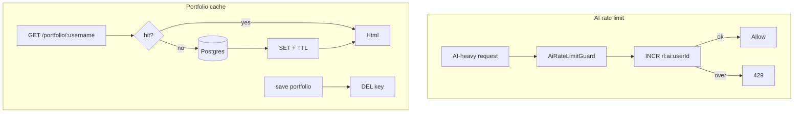

| Concern | Key | Default | Implementation |
|---------|-----|---------|----------------|
| Rate limit | `rl:ai:{userId}` | 30 / 3600s | `AiRateLimitGuard` |
| Portfolio HTML | `cache:portfolio:html:{username}` | TTL 300s | `PortfolioService` (invalidate on save) |

**Guarded routes** (shared per-user counter):  
`/ai/*` (except health) · CV upload/tailor/compatibility/cover-letter/quick-build · project create & regenerate-bullets · interview-prep create, resolve-jd, mock, STAR regenerate.

Plan quotas remain in Postgres (`UsersService.checkUserLimit`). Redis only caps short-window bursts.

| Env | Default | Meaning |
|-----|---------|---------|
| `REDIS_HOST` | `localhost` | Use `redis` in Compose |
| `REDIS_PORT` | `6379` | Port |
| `REDIS_ENABLED` | `true` | `false` skips connect |
| `AI_RATE_LIMIT_MAX` | `30` | Max requests per window |
| `AI_RATE_LIMIT_WINDOW_SEC` | `3600` | Window length |
| `PORTFOLIO_CACHE_TTL_SEC` | `300` | Cache TTL |

```bash
docker run -d --name resumate-redis -p 6379:6379 redis:7-alpine
# or: docker compose -f docker-compose.dev.yml up redis
```

```
backend/src/shared/redis/          # module, service, constants
backend/src/common/guards/ai-rate-limit.guard.ts
```

Out of scope today: sessions, queues, analytics cache.

---

## Interview Prep RAG (pgvector)

RAG is **not a chat UI**. It only improves **which curated questions** get into an Interview Prep plan when the user creates one. Downstream (roadmap, STAR, mock, cheat sheet) stays the same — they consume the ranked question list RAG helped pick.

### Where it sits in the app

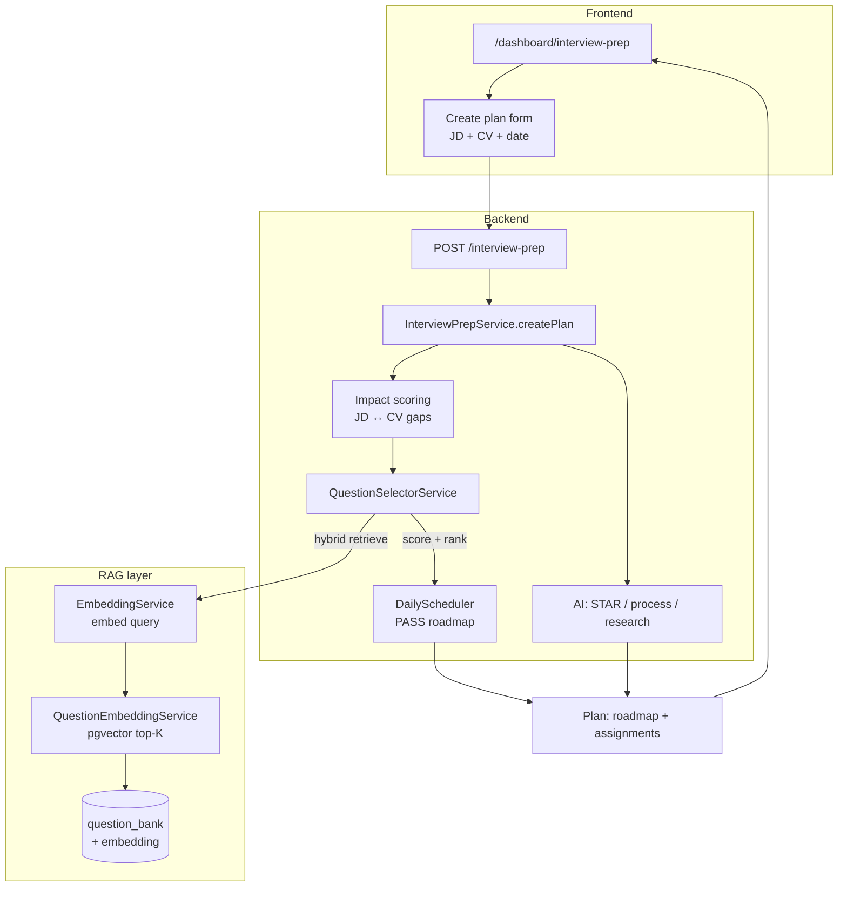

| App surface | Uses RAG? |
|-------------|-----------|
| Create Interview Prep plan | **Yes** — question candidate retrieval |
| Mark tasks / edit STAR / mock / cheat sheet | No — works on plan already saved |
| CV upload, Job Tailor, Portfolio, Analytics | No |

### Runtime interaction (create plan)

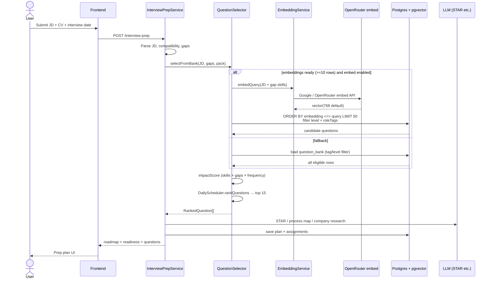

### Offline indexing (not on the request path)

Embeddings for the bank are built **ahead of time**, not when every user clicks Create.

```mermaid
flowchart LR
  Seed["Seed JSON\nquestion_bank"] --> Rows[("question_bank rows")]
  Rows --> Script["npm run backfill:question-embeddings"]
  Script --> OR[Google text-embedding-004\n(or OpenRouter)]
  OR --> Rows2[("UPDATE embedding\nembeddingModel, embeddedAt")]
  Rows2 -.->|used later by| Create["POST /interview-prep"]
```

| Piece | Detail |
|-------|--------|
| Extension | `vector` (`pgvector/pgvector:pg15` in Compose) |
| Column | `question_bank.embedding vector(768)` + `embeddingModel` / `embeddedAt` |
| Default model | Google **`text-embedding-004`** (AI Studio free tier) |
| Alt | `AI_EMBEDDING_PROVIDER=openrouter` — model dim must match `AI_EMBEDDING_DIMENSIONS` / DB |
| Hybrid | vector top‑K → same impact / PASS ranking as before |
| Fallback | full tag scan if embed off, API fail, or &lt;10 embedded rows |
| Code | `EmbeddingService`, `QuestionEmbeddingService`, `QuestionSelectorService` |

```bash
cd backend
npm run migration:run
npm run backfill:question-embeddings   # uses GOOGLE_AI_API_KEY by default
```

Env: `AI_EMBEDDING_PROVIDER=google`, `GOOGLE_EMBEDDING_MODEL=text-embedding-004`, `AI_EMBEDDING_DIMENSIONS=768`, `GOOGLE_AI_API_KEY`.

### External question banks (MIT supplements)

Curated seeds stay the core. Optional MIT imports **add** questions (never replace):

| Seed file | Source | Role tags |
|-----------|--------|-----------|
| `question-bank-external-faqguru.seed.json` | [FAQGURU](https://github.com/FAQGURU/FAQGURU) (MIT) | `software-engineer` |
| `question-bank-external-mlds.seed.json` | [Ajit DS Q&A](https://github.com/ajitsingh98/Data-Science-Interview-Questions-Answers) (MIT) + deduped [HF/Kaggle ML-DS](https://huggingface.co/datasets/haoxianc/shamimhasan8_ml-and-ds-coding-interview-question-bank) (~20 unique) | `data-scientist`, `machine-learning` |

```bash
cd backend
npm run import:external-question-banks   # regenerate seeds + EXTERNAL_ATTRIBUTION.md
# restart API → seeder upserts new ids
npm run backfill:question-embeddings     # embed new rows for RAG
```

Attribution: `backend/src/modules/interview-prep/data/EXTERNAL_ATTRIBUTION.md`.

### What the user sees

1. Same Interview Prep screens — no separate “RAG” button.  
2. Better question relevance to the JD (semantic match beyond hardcoded skill strings).  
3. If RAG is off / not backfilled, create plan still works; questions come from the legacy selector.

---

## Plans & limits

Enforced in `UsersService.checkUserLimit`:

| Feature | Free | Pro |
|---------|------|-----|
| CV uploads | 1 | Unlimited |
| Projects | 3 / period | Unlimited |
| Job tailor | 5 | Unlimited |
| Exports | 10 | Unlimited |
| Interview prep plans | 1 | Unlimited |
| Mock drills | 3 | Unlimited |

Pro also unlocks interview-prep pack features (mock scoring, cheat-sheet PDF, etc.).

---

## Project structure

```
resumate/
├── frontend/              # Next.js — landing, auth, dashboard
├── backend/               # NestJS API
│   └── src/modules/       # auth, users, cv, projects, portfolio,
│                          # templates, ai, analytics, interview-prep, notifications
├── deployment/            # Dev / prod scripts
├── testing/               # Playwright + Cucumber
├── docker-compose*.yml
└── requiments/            # Product notes (verify against code)
```

---

## Further reading

| Doc | Purpose |
|-----|---------|
| [IDEA.md](./requiments/IDEA.md) | Product intent |
| [INTERVIEW_PREP_FEATURE.md](./requiments/INTERVIEW_PREP_FEATURE.md) | Interview Prep contract |
| [README § RAG](#interview-prep-rag-pgvector) | Question bank vector retrieval |
| [JOB_TAILOR_FEATURES.md](./requiments/JOB_TAILOR_FEATURES.md) | Compatibility + cover letter |
| [deployment/README.md](./deployment/README.md) | Deploy / local scripts |
| [testing/README.md](./testing/README.md) | E2E harness |
| [frontend/README.md](./frontend/README.md) · [backend/README.md](./backend/README.md) | Package-level notes |

Other files under `requiments/` are historical — prefer this README and the codebase when they conflict.

---

## License

Private / UNLICENSED (see package manifests).
